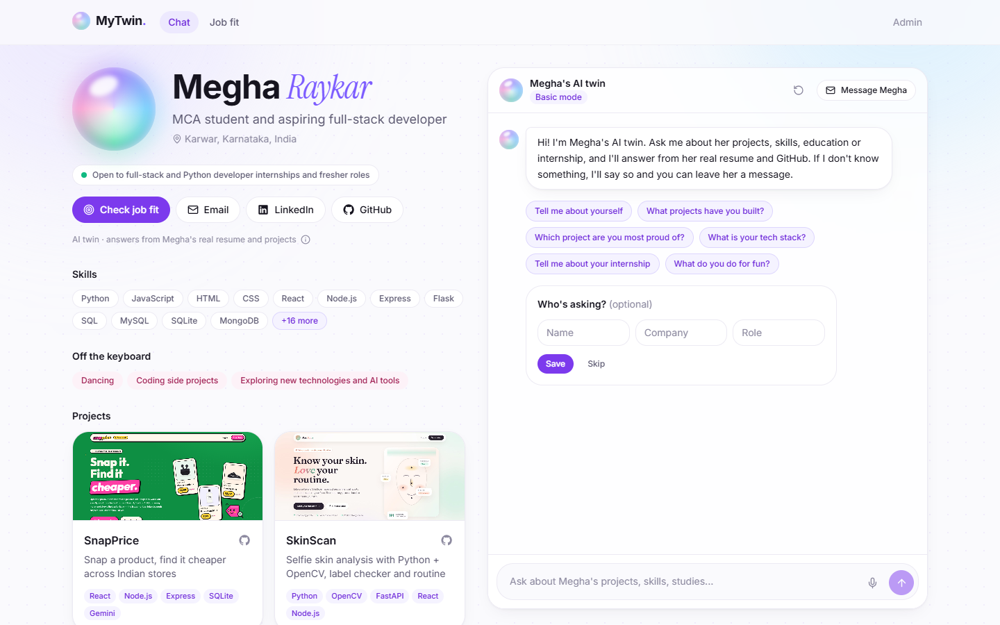
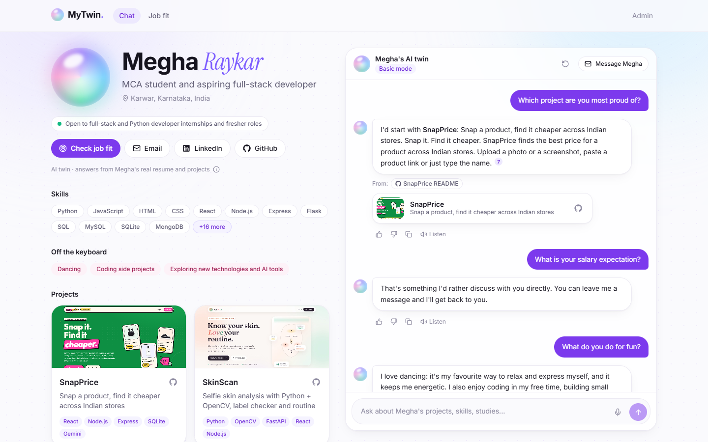
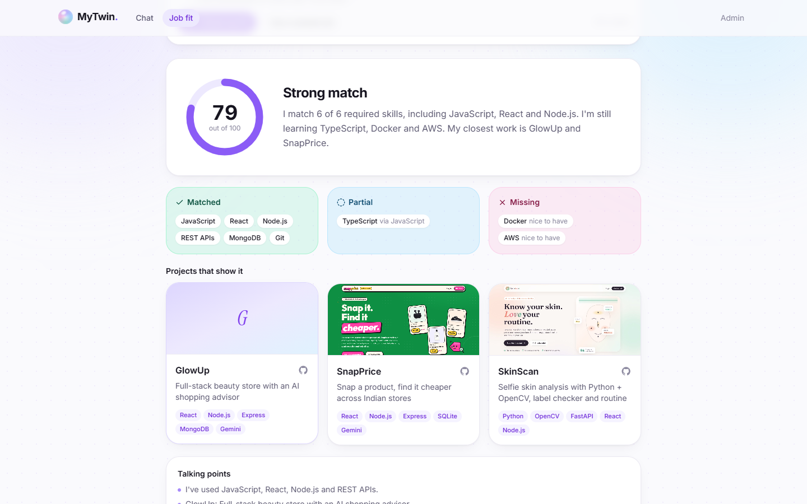
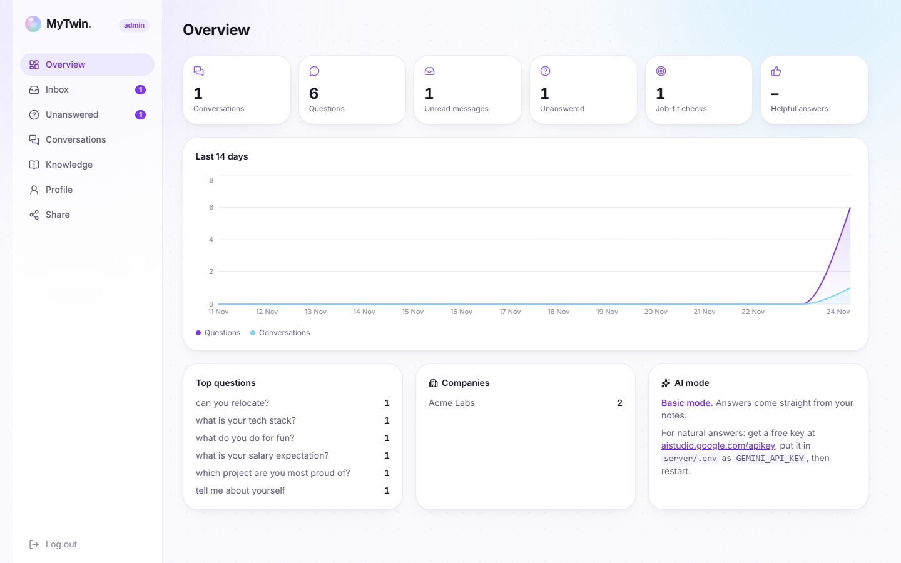
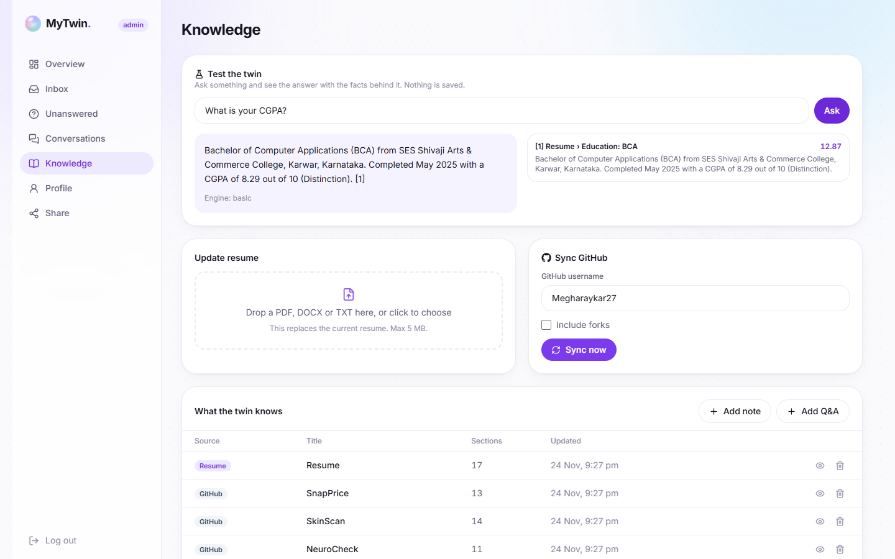
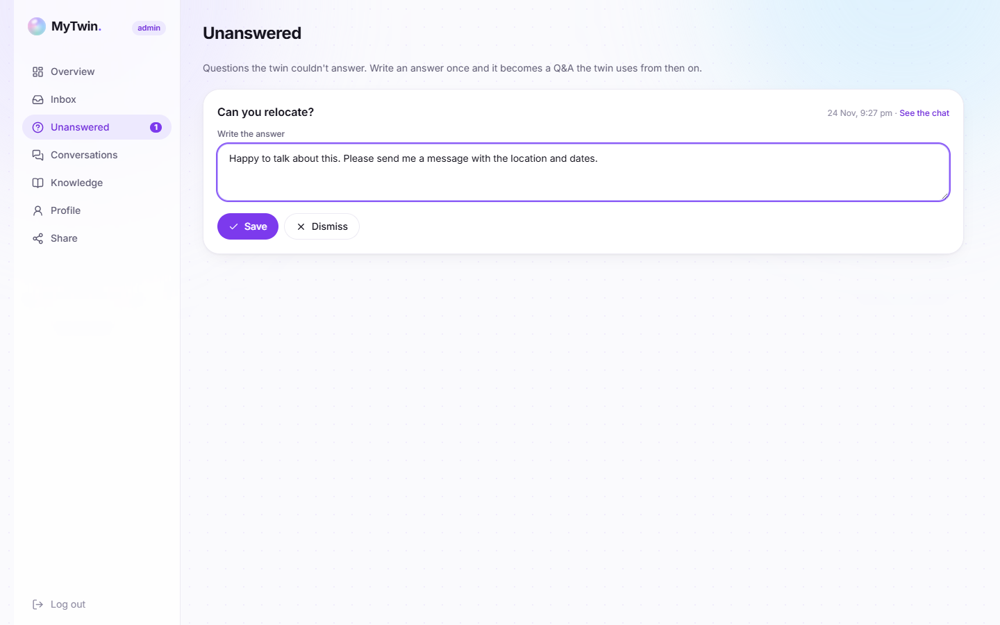
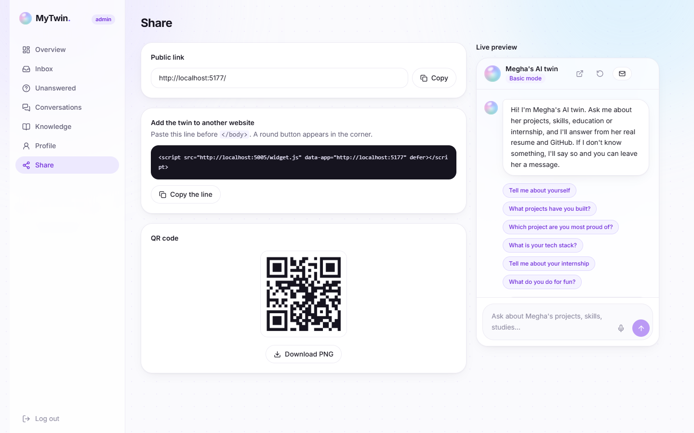
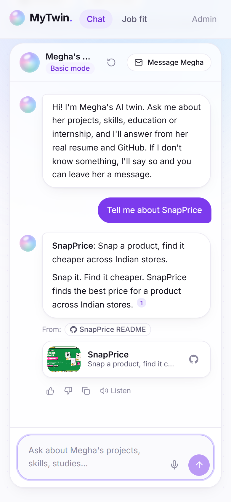

# MyTwin

**Talk to my AI twin.**

MyTwin is a website where recruiters chat with an AI twin of Megha Raykar. The twin answers in first person about her skills, projects, education, internship and hobbies, using **only facts from her real resume, project READMEs and notes**. Every answer shows its sources. If the twin doesn't know something, it says so and the recruiter can leave a message. Megha has an admin panel to update what the twin knows.



## Features

- **Answers from real facts.** The server first finds the matching facts, then the answer is written from those facts only (this is called RAG, retrieval-augmented generation).
- **Sources on every answer.** Small numbers like `[1]` open the exact fact that was used.
- **Live streaming.** The answer appears as it is written, and can be stopped at any time.
- **Works with no keys.** With a free Gemini key the answers sound natural. Without one, basic mode builds answers from the matching facts.
- **Honest about gaps.** Unknown questions go to a list in the admin panel. Megha answers once, and the twin knows it from then on.
- **Private topics stay private.** Salary, age, family and similar questions get a polite "let's discuss directly". Phone numbers are never shown.
- **Job-fit check.** Paste a job description and get a score with matched, partial and missing skills, and the closest projects.
- **Project cards** next to the answers, with links to GitHub.
- **Voice.** Ask by speaking and listen to the answers (in browsers that support it).
- **Leave a message.** Messages land in the admin inbox.
- **Admin panel:** stats, inbox, unanswered questions, conversations, resume upload (PDF, DOCX or TXT), GitHub sync, notes and Q&As, profile editor and a "Test the twin" box.
- **Widget.** One line of code adds the twin to any website.

## Screenshots

| Chat with sources and project cards | Job-fit check |
|---|---|
|  |  |

| Admin overview | Knowledge and "Test the twin" |
|---|---|
|  |  |

| Unanswered questions | Share and widget |
|---|---|
|  |  |

| Mobile | |
|---|---|
|  | |

The screenshots were taken in basic mode. The visitor and company in them are made up.

## Tech stack

| Part | Tools |
|---|---|
| Website | React 18, Vite, Tailwind CSS, Framer Motion, React Router, Recharts, axios, qrcode |
| API server | Node.js, Express, JWT + bcrypt, multer, helmet, rate limiting |
| Streaming | Server-sent events (SSE) read with `fetch` |
| Database | SQLite through Node's built-in `node:sqlite` (nothing to install) |
| Search | BM25 keyword ranking with synonyms, written from scratch |
| AI | Google Gemini, newest Flash model picked automatically (optional) |
| Resume import | unpdf (PDF) and mammoth (DOCX) |
| Tests | node:test with a mock Gemini and a mock GitHub |

## How it works

```
Question
   │
   ├─► Fixed replies: greeting, contact, private topics, tricks  ──► answer
   │
   ▼
BM25 search over the resume, READMEs, notes and Q&As
   │
   ├─► Gemini key set:  Gemini writes the answer from the numbered facts
   └─► No key (or Gemini is busy):  basic mode builds it from the facts
   │
   ▼
Answer streamed live, with sources and project cards
   │
   └─► Not in the facts?  "Leave a message" + the admin's Unanswered list
                              │
                              └─► Megha writes the answer ──► the twin knows it
```

## Run it locally

You need **Node.js 22.13 or newer**.

```bash
git clone https://github.com/Megharaykar27/MyTwin.git
cd MyTwin
npm run setup
npm run dev
```

Open http://localhost:5177. The admin panel is at http://localhost:5177/admin (the first visit creates the owner account).

## Optional Gemini key

| Key in `server/.env` | What you get |
|---|---|
| None | **Basic mode.** Everything works, answers come straight from the facts |
| `GEMINI_API_KEY` ([free key](https://aistudio.google.com/apikey)) | **Natural answers** written by Gemini from the same facts |

## Make it yours

1. Edit the files in `server/seed/` (`profile.json`, `resume.md`, `projects.json` and `readmes/`) before the first start, **or**
2. use the admin panel: upload your resume, sync your GitHub and edit your profile.

The seed files are loaded only when the database is empty. To load them again, stop the server and delete `server/mytwin.db`. This also deletes saved conversations and messages.

A few sentences are written for Megha: the "MCA, graduating 2027" note in `server/lib/fit.js`, the rules in `server/lib/twin.js` and the labels in `server/public/widget.js`. Change these too.

## Add the widget to a website

Paste this line before `</body>`. Replace the two addresses with your own.

```html
<script src="http://localhost:5005/widget.js" data-app="http://localhost:5177" defer></script>
```

## Tests

```bash
npm test
```

Runs the server tests (text tools, search, resume import, answers, job fit, GitHub sync, and the full API with a mock Gemini and with no key), then builds the website. The tests never call the real Gemini or GitHub.

## Project structure

```
MyTwin/
├── scripts/            one-command setup and tests
├── server/
│   ├── index.js        Express app
│   ├── lib/            database, search, knowledge, twin engine, job fit, skills
│   ├── providers/      Gemini
│   ├── routes/         auth, public, chat, fit, admin
│   ├── public/         widget.js
│   ├── seed/           starting data (profile, resume, projects, READMEs)
│   └── test/           unit and API tests
└── client/src/
    ├── pages/          Home, Fit, Embed and the admin panel
    ├── components/     Orb, ChatPanel, Message, ProjectCard...
    └── lib/            API client, streaming, voice
```

## API

| Method | Route | Who | What |
|---|---|---|---|
| GET | `/api/health` | public | Server check |
| GET | `/api/public/profile` | public | Profile and projects |
| POST | `/api/chat` | public | Start a conversation |
| GET | `/api/chat/:id` | public | Messages of a conversation |
| POST | `/api/chat/:id/messages` | public | Ask a question (streamed answer) |
| POST | `/api/chat/messages/:msgId/feedback` | public | Thumbs up or down |
| POST | `/api/fit` | public | Job-fit check |
| POST | `/api/leads` | public | Leave a message |
| GET | `/api/auth/status` | public | Is there an owner? |
| POST | `/api/auth/setup`, `/api/auth/login` | public | Create the owner (once), log in |
| GET | `/api/auth/me` | owner | Owner's email |
| GET | `/api/admin/overview` | owner | Stats |
| GET, DELETE | `/api/admin/conversations` | owner | Conversations |
| GET, POST | `/api/admin/unanswered` | owner | Open questions: answer or dismiss |
| GET, PATCH, DELETE | `/api/admin/leads` | owner | Inbox |
| GET, POST, PUT, DELETE | `/api/admin/knowledge` | owner | Notes, Q&As and documents |
| POST | `/api/admin/resume` | owner | Upload a resume |
| POST | `/api/admin/github/sync` | owner | Sync public repos |
| GET, PUT | `/api/admin/profile` | owner | Profile |
| GET, PATCH | `/api/admin/projects` | owner | Projects |
| POST | `/api/admin/test-question` | owner | Try a question (not saved) |
| GET | `/widget.js` | public | The widget |

## Privacy

- Phone numbers in uploaded resumes, READMEs and notes are hidden automatically.
- No tracking cookies. The browser only remembers the current chat.
- Conversations and messages are stored only in the database on your own server.
- With a Gemini key, the question, the last few messages and the matching facts are sent to Google to write the answer. In basic mode nothing is sent.

## Limitations

- Answers are only as good as the knowledge base.
- Basic mode is less natural, and can pick a loosely related fact for an unusual question.
- The job-fit check compares skill names, so it can't judge how deep a skill goes. A skill mentioned in a project README counts as a skill.

## Author

**Megha Raykar** · [GitHub](https://github.com/Megharaykar27) · [LinkedIn](https://www.linkedin.com/in/megha-raykar-335617337)
